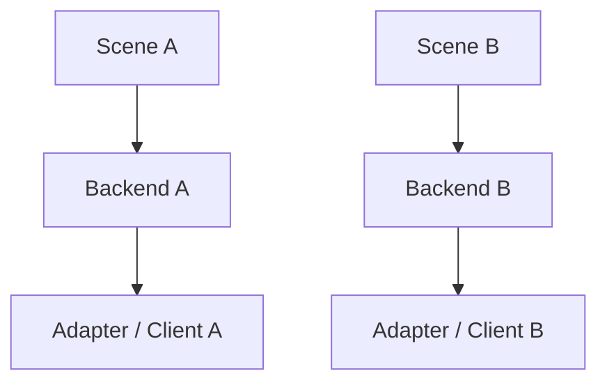

# 当前实现与剩余风险

> Status: Implemented  
> Previous: [01_scope_and_boundaries.md](01_scope_and_boundaries.md)  
> Next: [03_target_architecture.md](03_target_architecture.md)

## 当前调用链

```text
SimulatorEnvClient
→ SimulationServer
→ BackendRegistry.create(control.protocol)
→ per-scene AirSimBackend / UnrealCvBackend
→ Adapter / ControlStrategy
```

`SimulatorEnvClient`是唯一公开客户端。它直接委托 `SimulationServer`；
Local/Remote 与 AirSim/UnrealCV 是两个独立配置轴：

```text
connection.mode  = local | remote
control.protocol = airsim | unrealcv
```

因此四种组合都走相同 API，不需要四个 Client 子类。

## 已完成的结构调整

| 原问题 | 当前实现 |
|---|---|
| Client 和 Server 名称只表达 local | 收敛为 `SimulatorEnvClient`与 `SimulationServer` |
| AirSim Backend 带 Benchmark 名称 | 使用通用 `AirSimBackend` |
| 无独立行为的 Local UE Backend | 已删除，部署位置交给 `SceneProcessControl` |
| 同协议场景共享可变 Adapter | Registry 为每个 `scene_instance_id`创建 Backend |
| Runtime 固定 takeoff/hover/land | `SceneCapabilities`驱动预检和关闭 |
| provider 隐式决定 protocol | 强制显式 `control.protocol` |
| 三种重叠 remote mode | 收敛为 `connection.mode=remote`内部 attach-or-start |
| Remote 依赖安装 FlyAgent/systemd | 自动上传一次性标准库 Worker |
| 远端 RPC 端口需要直接暴露 | Backend 连接 SSH Tunnel 的本地动态端口 |
| UnrealCV takeoff/land 假成功 | 能力声明为 unsupported |

## 场景状态隔离



`SimulationServer`分别保存 SceneInstance、Backend 和 Tunnel。停止场景会释放
对应 Backend 与本地端口；失败启动也执行同范围清理。

## Remote ownership

Remote 启动分为两种结果：

- 协议探测成功：`process_ownership=external`，只 attach，`stop_scene`不停止 UE；
- 端口关闭且配置 executable：Worker 启动 UE，
  `process_ownership=remote_managed`，停止前验证 PID、start ticks 与 executable。

TCP 端口开放但协议不匹配会作为冲突失败，不会覆盖或结束未知进程。

## 当前剩余风险

| 风险 | 状态 | 处理方式 |
|---|---|---|
| 真实远程 env_1 网络暂不可达 | Pending external validation | 服务器/VPN 恢复后运行统一 manual probe |
| 首次真实验收只覆盖 AirSim ComputerVision | Known scope | Remote UnrealCV 已做契约测试，等待真实环境 |
| 同一主机并发多个 UE 的 GPU/远端端口分配 | Deferred | 当前配置显式指定端口与 GPU 参数 |
| 部分旧文档仍描述历史迁移名称 | Documentation history | 以本目录 README 和当前代码为准 |

## 后端冗余审计

本轮只记录，不删除下列文件或符号。

### 整个文件确认无调用

| 文件 | 证据 | 后续建议 |
|---|---|---|

### 已由统一架构替代并保持删除

```text
src/env_client/local_client.py
src/env_client/remote_client.py
src/sim_server/backends/airvln_backend.py
src/sim_server/backends/local_ue_backend.py
```

### 文件有效，但存在零调用符号

| 文件 | 零调用内容 | 文件仍需保留的原因 |
|---|---|---|
| `process_control.py` | `SceneProcessControl` | `LocalSceneControl`仍负责本地进程 |
| `airsim/uav.py` | `_canonical_position()`、`_current_yaw_deg()` | AirSim Adapter 和策略是生产控制路径 |
| `server.py` | `_wait_for_tcp_port()`、`_wait_for_airsim_rpc()`、`_launch_args()`、`list_maps()`、`get_scene_status()` | `SimulationServer`是统一生命周期入口 |
| `registry.py` | `protocols()` | Registry 仍负责每场景 Backend 多态创建 |

`MapPackage.provider`当前只作为 metadata 保存，不参与 Backend 路由；真正路由字段是
`control.protocol`。它属于后续 Schema 审计范围，本轮同样保留。

自动化测试验证实现契约；真实 UE 是否通过只记录在
[08_remote_airvln_test.md](08_remote_airvln_test.md)，两者不混淆。
