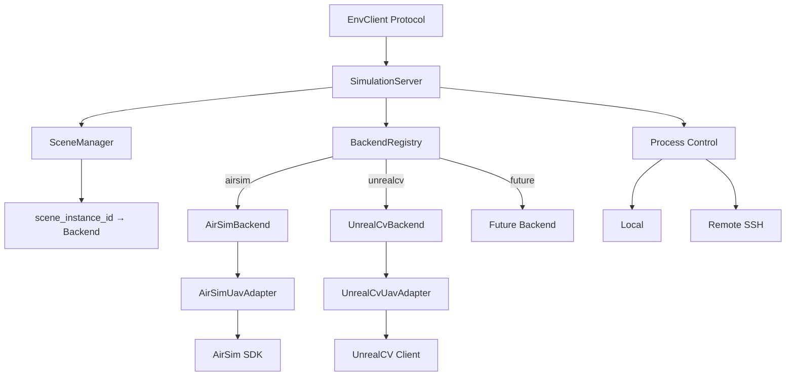

# 目标架构与多态扩展

> Status: Implemented  
> Previous: [02_current_state_and_debt.md](02_current_state_and_debt.md)  
> Next: [04_scene_lifecycle_and_capabilities.md](04_scene_lifecycle_and_capabilities.md)

## 核心抽象

```text
EnvClient Protocol
SimulationBackend Protocol
BackendRegistry
Per-scene Backend Instance
SceneProcessControl
AirSimControlStrategy
```



## 为什么使用 Protocol

FlyAgent 使用 Python 结构化多态：

```python
@runtime_checkable
class SimulationBackend(Protocol):
    def start(...): ...
    def stop(...): ...
    def reset(...): ...
    def execute_action(...): ...
    def get_observation(...): ...
    def describe_capabilities(...): ...
```

`AirSimBackend`不需要继承共享实现，只要满足方法契约即可注册。这样可以避免为了继承而把不同协议的状态和错误处理塞进一个基类。

Registry 负责两类验证：

- 注册时拒绝重复或空 protocol；
- 测试中验证每个默认 Backend 满足 SimulationBackend contract。

## BackendRegistry

目标接口：

```python
class BackendRegistry:
    def register(self, protocol: str, factory: BackendFactory) -> None: ...
    def create(self, protocol: str, options: BackendOptions) -> SimulationBackend: ...
    def protocols(self) -> tuple[str, ...]: ...
```

默认注册：

```text
airsim   → AirSimBackend
unrealcv → UnrealCvBackend
```

未知协议必须报告可用值，不能回退到 AirSim。

## Per-scene Backend

SimulationServer 保存：

```text
scene_instance_id → SimulationBackend
```

而不是：

```text
control.protocol → shared SimulationBackend
```

每个 scene 独立拥有：

- SDK client；
- vehicle/camera；
- pose state；
- artifact 目录；
- reset/close 状态；
- capability snapshot。

stop_scene 后必须从映射中移除 Backend；启动失败时也要清理半初始化实例。

## 扩展新模拟器

新增协议固定遵循：

```text
实现 SimulationBackend
→ 注册 protocol
→ 编写 MapPackage
→ 增加 contract tests
```

例如接入 Gazebo：

```python
registry.register("gazebo", GazeboBackend)
```

配置：

```json
{
  "control": {"protocol": "gazebo"}
}
```

EnvClient、Runtime 和 Benchmark 不需要增加 `if gazebo` 分支。

## 两条内部路由

SimulationServer 同时处理两条正交路由：

```text
connection.mode → SceneProcessControl
control.protocol → SimulationBackend
```

Local/Remote 决定“场景在哪里、由谁启动”；AirSim/UnrealCV 决定“动作和观测用什么协议”。Backend 不应负责 SSH，Remote Worker 也不应实现飞行动作。
