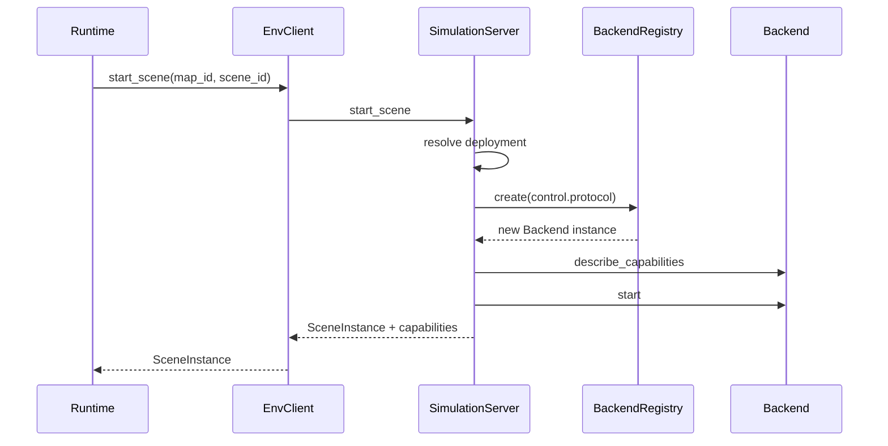
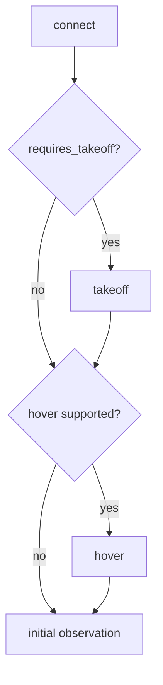

# Scene 生命周期与能力协商

> Status: Implemented  
> Previous: [03_target_architecture.md](03_target_architecture.md)  
> Next: [05_local_and_remote_deployment.md](05_local_and_remote_deployment.md)

## SceneInstance

SceneInstance 描述一次运行中的场景，不描述静态 Benchmark case。字段按职责分组：

```text
identity
    scene_instance_id
    map_id
    scene_id
    machine_id

endpoint
    control_host
    control_port

lifecycle
    status
    process_ownership
    process_id
    remote_process_id

reproducibility
    settings_path
    settings_sha256

capabilities
    SceneCapabilities
```

不再保留重复字段 `host`、`server_port`、`airsim_port`；Tunnel 的本地
endpoint 直接写入 `control_host/control_port`。

## SceneCapabilities

```text
protocol
control_mode
supported_actions
observation_modalities
requires_takeoff
supports_soft_reset
```

能力来自 Backend 和已验证 settings，而不是未经消费的自由字典。

| 场景类型 | requires_takeoff | 主要动作 | 观测 |
|---|---:|---|---|
| AirSim Multirotor | true | connect、takeoff、hover、land、move、turn、set_pose | RGB、Depth、Pose |
| AirSim ComputerVision | false | connect、hover、move、turn、set_pose、ascend、descend | RGB、Depth、Pose |
| UnrealCV Camera | false | connect、hover、move、turn、set_pose、ascend、descend | RGB、Depth、Pose |

ComputerVision 和 UnrealCV 的 hover 表示保持当前 pose；takeoff 和 land 不伪造成功。

## 场景启动



启动顺序必须保证：

1. MapPackage 验证成功后才分配资源；
2. 进程或 remote attach ready 后才启动 Backend；
3. Backend.start 成功后才注册为 running；
4. 任一步失败都清理本次拥有的进程、Tunnel、端口和 Backend；
5. 外部 attach 的进程不因本地启动失败而被停止。

## 能力驱动预检



Runtime 规则：

- connect 成功后 `connected=true`；
- 只有真实 takeoff 成功后 `airborne=true`；
- ComputerVision 和 UnrealCV 保持 `airborne=false`；
- capability skip 写入 debug event，但不是动作失败；
- Planner 的可用 action schemas 后续应从同一 capability snapshot 过滤。

## Action 与 Observation 路由

```text
scene_instance_id
→ SceneManager.get()
→ scene_backends[scene_instance_id]
→ execute_action / get_observation
```

Backend 不允许根据 map_id 查找全局单例。未知或已停止 scene 必须返回明确错误。

## Reset

软重置：

- Backend/Adapter reset；
- 保留 UE 进程和 Tunnel；
- 重新连接协议；
- 恢复 scene status=running。

硬重置：

- stop 当前 owned scene；
- 重新准备 settings；
- 重新启动并创建新的 SceneInstance，或由更高层显式请求。

第一版 EnvClient 的 `reset_scene`代表软重置。硬重启不能被同名 API 静默触发。

## Stop 与 ownership

| ownership | stop_scene 行为 |
|---|---|
| local | 关闭 Backend，停止本地 owned process，释放端口 |
| remote_started | 关闭 Backend，Remote Worker 停止 owned process，关闭 Tunnel |
| remote_attached | 关闭 Backend 和 Tunnel，不停止外部 UE |

shutdown policy 同样能力驱动：

```text
hover supported → best-effort hover
land requested and supported → land
land unsupported → capability_skip
stop_scene → ownership cleanup
```
