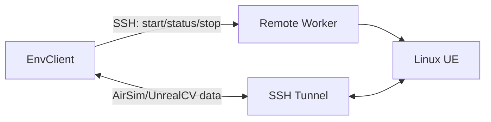
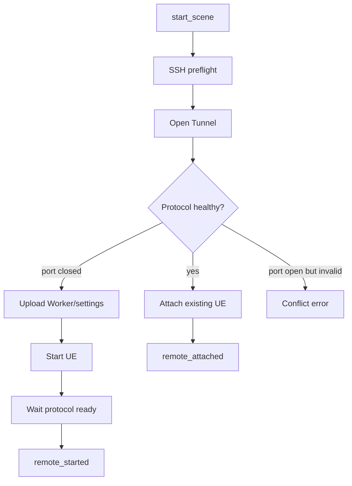

# Local 与 Remote 部署

> Status: Implemented  
> Previous: [04_scene_lifecycle_and_capabilities.md](04_scene_lifecycle_and_capabilities.md)  
> Next: [06_backend_and_adapter_contracts.md](06_backend_and_adapter_contracts.md)

## 部署层只回答“场景在哪里”

部署位置由：

```text
connection.mode = local | remote
```

决定。它不决定 AirSim、UnrealCV 或未来模拟器协议。

## Local

```text
ProcessManager
→ executable
→ settings / launch args
→ ready check
→ process ownership=local
```

Local ProcessManager 负责：

- 解析 Windows/Linux/WSL executable；
- 参数列表执行；
- 保存 stdout/stderr；
- 记录 PID；
- 只停止当前 scene 创建的进程；
- 将控制 endpoint 交给 Backend。

手动启动的本地 UE 可以使用 `launch.manual=true`并由运行参数选择只连接，但不再引入新的 connection mode。

## Remote

```text
SshRemoteSceneControl
→ Remote Worker
→ UE process
→ SSH Tunnel
```



SSH 是控制面；AirSim/UnrealCV 是数据面。Remote Worker 不转发动作、RGB、Depth 或 Pose。

## Remote attach/start



判定要求：

- 不能只依据 TCP connect 判断 AirSim healthy，必须完成协议 ping；
- 端口开放但协议 handshake 失败时，不启动第二个 UE；
- attach 后记录 `remote_attached`，stop 不结束外部进程；
- start 后记录 `remote_started`和 registry identity。

## Remote 子包

实现目录：

```text
src/sim_server/remote/
├── __init__.py
├── control.py
├── ssh.py
├── tunnel.py
└── worker.py
```

职责：

| 文件 | 责任 |
|---|---|
| `control.py` | Worker bootstrap、spec/settings 上传、生命周期编排 |
| `ssh.py` | OpenSSH 命令、upload、download、错误格式化 |
| `tunnel.py` | `ssh -L`数据通道和进程健康 |
| `worker.py` | Linux 上执行 start/status/stop/logs 的标准库单文件 |

## Remote Worker

Worker 的约束：

- 只依赖 Linux Python 3 标准库；
- 按 SHA-256 上传到内容寻址缓存；
- 不要求安装 FlyAgent；
- 不要求 root；
- 不使用 `pkill`或按进程名批量结束；
- registry 保存 PID、PGID、start ticks、executable、settings hash；
- stop 前验证进程身份；
- SIGTERM 超时后只 SIGKILL 对应进程组。

Worker 使用 `subprocess.Popen(..., start_new_session=True)`创建 detached
process group，因此不依赖 systemd、linger 或管理员权限。

## Settings 与文件位置

远端原始模板可以只读下载到本次 run 目录，经验证后生成 scene 副本，再上传：

```text
remote source settings
→ local run/scenes/<id>/source-settings.json
→ rendered-settings.json
→ remote ~/.flyagent/scenes/<id>/settings.json
```

原始模板不能被覆盖。场景副本记录 SHA-256。

Worker 缓存：

```text
~/.cache/flyagent/remote-worker/<sha256>/worker.py
```

场景运行目录：

```text
~/.flyagent/scenes/<scene_instance_id>/
```

## SSH 安全默认值

```text
BatchMode=yes
StrictHostKeyChecking=yes
ConnectTimeout
ServerAliveInterval
ServerAliveCountMax
ExitOnForwardFailure=yes
```

只支持密钥认证。AirSim 端口默认通过 Tunnel 访问；direct 仅用于可信局域网或 VPN。
