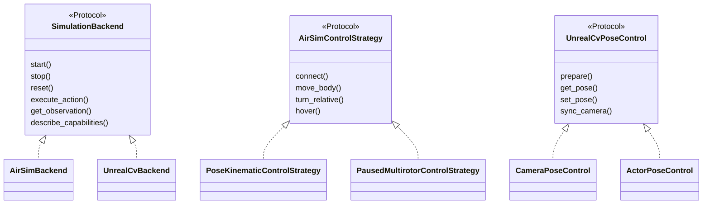
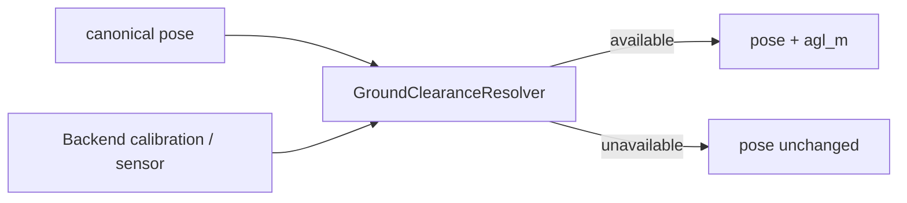

# Backend 与 Adapter 契约

> Status: Implemented  
> Previous: [05_local_and_remote_deployment.md](05_local_and_remote_deployment.md)  
> Next: [07_configuration_reference.md](07_configuration_reference.md)

## 三层多态

目录责任：

- `src/uav/` 保存纯数学：坐标、yaw、pose delta 和距离。
- `src/adapters/` 保存协议 I/O；两个 UAV Adapter 都返回 `PrimitiveResult`。
- `src/sim_server/backends/` 负责场景绑定、capabilities、primitive 分派和结果包装。
- `src/sim_server/` 负责进程、settings、SSH 与所有权清理。

AirSim 的 `airsim/control.py` 选择控制策略，`airsim/actions.py` 执行物理动作、
读取 Future.get()、记录前后状态并在 finally 中 freeze。后者通过回调复用策略的
pose 和 freeze 实现，不管理场景。图像采集保留在 `airsim/uav.py`。

UnrealCV 的 `unrealcv/uav.py` 组合 `unrealcv/control.py` 与
`unrealcv/capture.py`；这三个文件均位于 `src/adapters/`。Backend 保留
MapPackage 对应的 AGL enrichment。释放连接只关闭 Adapter client，后续动作可
按原有行为重新连接。目标人物/车辆布置仍由 Benchmark ScenarioController 负责。

真实动作诊断可运行 `tests/manual/airsim_action_regression_probe.py --help`。
它只输出 primitive 和 cleanup 证据，不能作为 benchmark 导航分数。

```text
SimulationBackend
    AirSimBackend
    UnrealCvBackend

UavPrimitiveAdapter
    AirSimUavAdapter
    UnrealCvUavAdapter
    NullUavPrimitiveAdapter

AirSimControlStrategy
    PoseKinematicControlStrategy
    PausedMultirotorControlStrategy

UnrealCvPoseControl
    CameraPoseControl
    ActorPoseControl

UnrealCvCapture
    scene
    depth_perspective
    segmentation
```



虚线实现关系表示 Protocol 结构化多态，不要求共享实现基类。

## SimulationBackend

Backend 负责：

- 描述 scene capability；
- 创建/关闭协议 Adapter；
- 将统一 action 分派到 primitive；
- 将 primitive result 包装成 ActionResult；
- 获取 Observation；
- 执行协议级软 reset。

Backend 不负责：

- 启动或杀死 UE；
- SSH/SCP；
- Benchmark case、goal 或 reference path；
- 模型规划和安全策略。

## AirSimBackend

AirSimBackend 适用于所有 AirSim-compatible UE：

```text
本地 UE
远程 UE
AerialVLN 地图
TravelUAV 地图
未来 AirSim 地图
```

它不能再叫 `AirVlnBackend`。地图来源可以留在 MapPackage.provider 作为元数据，但不能参与 Backend 路由。

AirSimBackend 必须使用 SceneInstance 中已解析的：

```text
control_host
control_port
```

否则 SSH Tunnel 会被绕过。

## AirSimControlStrategy

动作映射：

| 动作 | pose_kinematic | paused_multirotor | UnrealCV |
|---|---|---|---|
| connect | VehicleClient | MultirotorClient | UnrealCV Client |
| move_body | simSetVehiclePose | unpause + velocity API + freeze | configured camera/actor pose |
| turn_relative | pose yaw | unpause + yaw API + freeze | configured camera/actor yaw |
| hover | keep pose | zero kinematics + pause | reapply configured target pose |
| takeoff | unsupported | unsupported; use episode initial pose | unsupported |
| land | unsupported | unsupported | unsupported |
| get pose | simGetVehiclePose | getMultirotorState | configured camera/actor pose |
| RGB/depth | simGetImages | simGetImages | vget camera |

ComputerVision body-frame 位移：

```text
dx = (cos(yaw) * vx - sin(yaw) * vy) * duration
dy = (sin(yaw) * vx + cos(yaw) * vy) * duration
dz_ned = -vz * duration
```

计算后通过 `simSetVehiclePose`更新位置，同时保留未修改的姿态分量。

paused Multirotor 只在正式动作期间恢复物理。episode placement 和动作终点使用
零速度 Kinematics，并在采集 observation 前保持 pause；零速度稳定命令不会再次
打开物理窗口。这样保留动作路径上的 AirSim 碰撞，同时避免 idle hover 漂移。

## UnrealCV camera 与 actor 控制

UnrealCV 的协议和受控目标是两个不同概念：

```text
control.protocol=unrealcv
    ├── control_target=camera → CameraPoseControl
    └── control_target=actor  → ActorPoseControl
```

`camera`模式保留适用于自由相机地图的原生坐标行为。`actor`模式用于地图已经暴露
主无人机、车辆或机器人 Actor 的情况：

- Object location 在 Backend 内按 `units_per_meter`转换成米；
- Object rotation 的 `[roll, yaw, pitch]`顺序在策略边界转换；
- 标准 Object rotation 使用 `yaw_offset_deg`在 canonical yaw 与 Actor native
  yaw 之间换算；
- `unrealcv.startup.hide_objects`可声明连接时需要隐藏 mesh 的打包地图 Actor；
- `scale`可恢复打包地图要求的主 Actor 启动比例，不由 Benchmark 修改；
- 标准 Actor 使用 `standard_pose`；
- 只提供 Blueprint yaw 的打包地图使用 `blueprint_yaw`；
- 采图前可用标准 `standard_pose`或地图扩展 `blueprint_pose`把相机同步到 Actor。

`blueprint_yaw`只能改变 yaw。如果调用者请求改变 pitch/roll，策略明确失败，不能
返回伪成功。Backend 在发送 Blueprint 命令前应用 `yaw_offset_deg`；Blueprint
完成内部 mesh 朝向修正后，Actor readback 就是相机物理 yaw，并作为 canonical yaw
返回。Backend 轮询 readback，达到 tolerance 后才返回成功。Actor 不存在、超时或
Blueprint 命令失败时都不会回退到 camera 模式。

## UnrealCV 观测批次

`UnrealCvCapture`按 ObservationProfile 将通用 capture source 转为命令：

| Capture source | 命令 | Artifact |
|---|---|---|
| `scene` | `vget /camera/<id>/lit png` | RGB PNG |
| `depth_perspective` | `vget /camera/<id>/depth npy` | 米制 NPY + preview |
| `segmentation` | `vget /camera/<id>/object_mask png` | PNG |

同一次 observation 中的图像命令通过一个 `request_batch()`发送。Actor 模式先同步
相机，再批量采集。严格的“画面是否纯色”判断只属于 Demo/manual probe，Backend
只验证协议载荷是否可解码。

## 可选 AGL enrichment

AGL 不增加 EnvClient 方法，也不成为新的 observation modality。Backend 在 canonical
Pose 生成后调用内部 `GroundClearanceResolver`；只有地图或传感器提供可靠地面参考时，
返回的 Pose 才增加 `agl_m`。没有可靠来源时字段保持缺失，不能用 `0`代表未知。



当前 UnrealCV Actor 实现使用局部落地原点标定；未来 AirSim 距离传感器可以实现同一
内部边界，不需要改变 Runtime 或 EnvClient v1。

## 场景编辑不属于 EnvClient

控制主 UAV Actor 与摆放 Benchmark 目标是两个责任：

```text
UnrealCvBackend → UnrealCvUavAdapter → 主 UAV/camera、pose、frames
Benchmark Scenario → 人物/车辆创建、隐藏、外观、目标位置
```

冻结的 EnvClient 不增加 `spawn_object`、`set_appearance`或目标放置方法。未来若
多个 Benchmark 需要共享场景编辑能力，应建立独立的特权 `ScenarioAdmin`，而不是
扩展飞行控制接口。

## 坐标契约

FlyAgent primitive 使用 canonical convention：

```text
+X: forward
+Y: right
+Z: up
positive yaw: canonical relative turn
```

Simulator-specific NED、UE 坐标或 camera rotation 必须在 Adapter 边界转换。Benchmark 原始坐标先由其 evaluation adapter 转成 canonical pose，再调用 EnvClient。

## Unsupported 行为

不支持的动作返回：

```json
{
  "ok": false,
  "message": "uav.takeoff is not supported by pose_kinematic",
  "data": {
    "error_code": "unsupported_action",
    "control_mode": "pose_kinematic"
  }
}
```

Runtime 应通过 capability 避免正常流程调用 unsupported action；Backend 的错误仍是最后一道契约保护。

## Contract tests

每个注册 Backend 必须共享一组 contract tests：

- start 后 status=running；
- stop 可重复清理；
- reset 返回可用 SceneInstance；
- unknown action 明确失败；
- observation shape 一致；
- capability 与实际动作一致；
- 两个 scene 的 Backend/Adapter 状态隔离。
