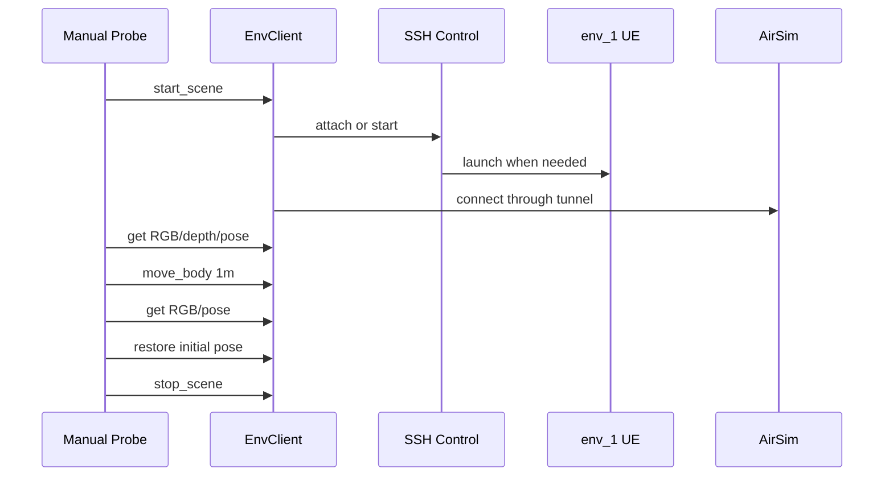

# 远程 AirVLN env_1 验收

> Status: Implemented; Real engine visual validation: Passed (2026-07-30)  
> 本文是具体部署验收记录，不定义通用 Backend 架构。  
> Previous: [07_configuration_reference.md](07_configuration_reference.md)  
> Next: [09_migration_and_acceptance.md](09_migration_and_acceptance.md)

## 已确认环境

以下信息已由本轮 SSH preflight 和真实 EnvClient probe 核验：

```text
SSH: wzq@10.68.240.49:10182
HOME: /home/wzq
Python: 3.10.12
user systemd: running
Linger: no
GPU: 4 × NVIDIA GeForce RTX 3090
UE root: /home/Newdisk/wzq/data/airvln/ENVs
```

本机 SSH config 已包含对应主机和 key，known_hosts 已记录该端口的主机指纹。项目配置仍通过 `${FLYAGENT_SSH_KEY}`注入 key path，避免把个人路径写入 Benchmark case。

## env_1

Executable：

```text
/home/Newdisk/wzq/data/airvln/ENVs/env_1/env_1/LinuxNoEditor/AirVLN.sh
```

Settings：

```text
/home/Newdisk/wzq/data/airvln/AirVLN/airsim_plugin/settings/1/settings.json
```

已确认 settings：

```text
SettingsVersion: 1.2
SimMode: ComputerVision
ApiServerPort: 30001
Vehicle: Drone_1
VehicleType: ComputerVision
Camera: front_0
RGB: 224 × 224
Depth: 256 × 256
```

AirVLN 原始 launcher 使用：

```text
bash <AirVLN.sh> -RenderOffscreen -NoSound -NoVSync -GraphicsAdapter=<id> --settings <path>
```

## 验收流程



详细步骤：

1. 使用 BatchMode 和严格 host-key 校验执行 SSH preflight；
2. 检查 executable、settings、Python、GPU 和 30001 端口；
3. 只读下载 settings 到本次 run；
4. 验证并生成 scene settings 副本；
5. 建立 SSH Tunnel；
6. AirSim ping 成功则 attach，否则自动上传 Worker 并启动；
7. 通过 `SimulatorEnvClient.execute_action("connect")`连接；
8. 获取初始 RGB、Depth、Pose；
9. 通过 ComputerVision strategy 执行 body-frame 前进 0.5 米；
10. 再次获取 RGB 和 Pose，验证位移；
11. 使用 set_pose 恢复初始位姿；
12. soft reset；
13. stop_scene，根据 ownership 决定是否停止 UE；
14. 保存 Worker status 和 UE log tail。

## 命令

目标配置文件是仓库中的通用 Remote MapPackage：

```text
configs/maps/remote_ssh.example.json
```

PowerShell：

```powershell
$env:FLYAGENT_SSH_KEY = "$env:USERPROFILE\.ssh\id_rsa_npu_wzq"

python tests/manual/remote_ssh_scene_probe.py `
  --config configs/maps/remote_ssh.example.json `
  --map-id airsim_remote_env_1 `
  --observation-profile configs/observations/airsim_depth_vis.example.json
```

该 probe 只通过 `SimulatorEnvClient`调用底层，不构造专用 Remote Client。
正式 AerialVLN-S 使用
`configs/maps/aerial_vln_s_remote.example.json`，并通过
`launch.existing_process_policy=reject`拒绝附着到身份未知的已有 scene。

## 预期输出

```text
runs/manual_remote_ssh_probe/<run-id>/
├── map_package.json
├── remote_probe_report.json
├── scene_instance.json
├── source.settings.after.json
├── observation_profile.json
├── artifacts/
└── scenes/<scene-instance-id>/
    ├── source.settings.json
    └── settings.json
```

`remote_probe_report.json`至少记录：

- attach 或 started；
- Worker launcher；
- Tunnel 本地端口与远端端口；
- settings SHA-256；
- 初始和最终 pose；
- 实际 pose delta；
- reset/stop 结果；
- RGB/Depth 尺寸与 settings 的一致性；
- cleanup 后远端 AirSim 端口是否释放。

## 2026-07-29 实机结果

通过的 run：

```text
runs/manual_remote_ssh_probe/20260729_194908/
```

结果：

- `SimulatorEnvClient`自动上传一次性 Worker 并启动远端 UE；
- AirSim ComputerVision 通过本地 Tunnel `127.0.0.1:35001`连接；
- RGB 为 224 × 224，Depth 为 256 × 256、65536 个有限 float；
- `move_body`实际位移 0.5 m；
- `set_pose`恢复误差 0.0 m；
- soft reset 后重新连接并再次获取 RGB、Depth、Pose；
- 原始远端 settings 前后 SHA-256 均为
  `c664ddf0edc2fbe9c4e0049f044a2ca8e54597fb3ac2077501c66664ba3c5889`；
- 场景 ownership 为 `remote_managed`，结束后 Worker registry 为 `stopped`；
- 结束后远端 `127.0.0.1:30001`为 connection refused，确认本次 UE 已停止。

这一轮旧验收只检查 payload、尺寸和有限数值，后来确认它不足以发现纯黑 RGB 或恒定
Depth。因此以下 2026-07-30 严格视觉验收取代“文件非空即通过”的旧判定。

## 2026-07-30 严格视觉结果

通过的统一 Demo run：

```text
runs/simulator_env_client_demo/20260730_172854_224883/
```

该 run 使用独立 ObservationProfile：

```text
rgb   → scene
depth → depth_vis
```

Profile 由 Demo 上层注入，不属于 MapPackage，底层不存在 env_1 或 AirVLN 分支。

结果：

- RGB 224 × 224，初始帧标准差 47.42，唯一颜色数 24037；
- DepthVis 256 × 256，范围 0.01176–1.0，标准差 0.45257；
- RGB、Depth 在移动后、恢复后和 soft reset 后均通过严格检查；
- `move_body`位移 0.5 m，`set_pose`恢复误差 0.0 m；
- 场景 ownership 为 `remote_managed`，PID 58273 结束后不存在；
- 结束后远端 30001 未监听；
- 原始 settings SHA-256 仍为
  `c664ddf0edc2fbe9c4e0049f044a2ca8e54597fb3ac2077501c66664ba3c5889`。

通用 capture matrix 记录在：

```text
runs/manual_airsim_capture_matrix/20260730_172725_827842/
```

它确认 raw Scene 在 UE 刚 ready 时可能短暂为纯黑，严格 Demo 会等待有效帧；同时确认
当前服务的 DepthPerspective 为恒定 1.0，而 DepthVis 能返回有效深度。该事实只用于
上层选择 ObservationProfile，不会写入通用 Backend 的地图判断。

## 安全边界

- 不修改 AirVLN 原始 settings、DATA 或 ENVs；
- 不运行 `pkill AirVLN`；
- 不按端口结束未知进程；
- 端口开放但 AirSim handshake 失败时中止；
- `remote_attached`场景不停止人工启动的 UE；
- 测试结束恢复初始 pose；
- Worker 和 scene files 只写入远端用户目录下的 `.flyagent/scenes`。

Worker 始终使用 detached process group，不依赖 user-systemd 或 linger。

## 2026-07-30 TaskRuntime 对齐复测状态

本轮 Runtime 对齐完成后，计划使用
`tests/manual/task_runtime_episode_options_probe.py`再次执行“不移动”的
ComputerVision 初始化验收。执行时 `10.68.240.49:10182`连续三次 TCP 连接均在约
5 秒超时，SSH 握手无法开始，因此本轮状态明确为：

```text
Runtime initialization retest: BLOCKED_BY_NETWORK
Backend strict visual acceptance above: PASSED
```

没有启动或停止任何远程进程，也没有修改远端 settings。网络/VPN 恢复后可运行：

```powershell
$env:FLYAGENT_SSH_KEY = "$env:USERPROFILE\.ssh\id_rsa_npu_wzq"

python tests/manual/task_runtime_episode_options_probe.py `
  --config configs/maps/remote_ssh.example.json `
  --map-id airsim_remote_env_1 `
  --observation-profile configs/observations/airsim_depth_vis.example.json `
  --execution managed
```

该命令默认先读取当前 pose，再将相同 pose 作为 episode initial pose，不执行 Planner
飞行动作；`MANAGED`仍遵守 attach-or-start 和 ownership-aware cleanup。
