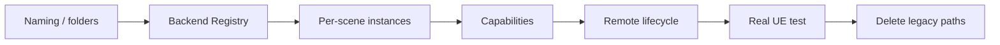

# 迁移阶段与验收标准

> Status: Implemented  
> Previous: [08_remote_airvln_test.md](08_remote_airvln_test.md)  
> Index: [README.md](README.md)

## 迁移原则

- 一次只改变一个架构轴；
- 每阶段完成单元测试后再进入下一阶段；
- 不在迁移中修改 Agent prompt、Benchmark evaluator 或 memory contract；
- 新旧行为冲突时删除旧路径，不保留无期限兼容别名；
- 真实 UE 测试最后执行，且只通过 EnvClient。



## 阶段一：命名与目录

修改：

```text
AirVlnBackend → AirSimBackend
LocalSimulationServer → SimulationServer
Remote 文件 → src/sim_server/remote/
```

删除无行为包装：

```text
LocalUeBackend
```

不修改：

- EnvClient public methods；
- action/observation shape；
- Runtime preflight。

测试：

- 全部 import 更新；
- AirSim/UnrealCV 现有测试通过；
- 搜索不到通用代码中的 `AirVlnBackend`。

完成条件：只有具体部署配置和 Benchmark 文档可以出现 AirVLN 名称。

回滚点：纯文件移动和命名提交。

## 阶段二：Backend 多态

新增：

```text
BackendRegistry
BackendOptions
SimulationBackend contract tests
```

修改：

```text
protocol → Backend factory
scene_instance_id → Backend instance
```

测试：

- 未知 protocol 明确失败；
- 重复注册失败；
- AirSim 和 UnrealCV 均满足 contract；
- 两个 AirSim scene 的 client/pose/artifacts 相互隔离；
- start 失败不残留 Backend。

完成条件：新增 Backend 不需要修改 EnvClient。

回滚点：Registry 与 per-scene mapping 提交。

## 阶段三：能力协商和 AirSim 策略

新增：

```text
SceneCapabilities
AirSimControlStrategy
ComputerVisionControlStrategy
MultirotorControlStrategy
```

修改：

- Runtime preflight/shutdown；
- AgentRuntime smoke test；
- Stabilizer optional hover；
- Unsupported action 错误；
- ComputerVision body-frame pose movement。

测试：

- Multirotor 执行 takeoff/hover/land；
- ComputerVision 跳过 takeoff，支持 move/turn/hover；
- UnrealCV 跳过 takeoff/land；
- MissionState 不把 pose-control scene 标记 airborne；
- capability 与实际 action 一致。

完成条件：AerialVLN ComputerVision 可通过普通 TaskRuntime preflight。

回滚点：Capabilities 与策略提交。

## 阶段四：Remote 控制

新增或重构：

```text
remote/control.py
remote/ssh.py
remote/tunnel.py
remote/worker.py
```

行为：

- Worker 内容寻址上传；
- remote settings 下载和场景副本；
- attach/start 自动判定；
- Tunnel endpoint；
- PID identity 验证；
- ownership-aware stop。

测试：

- SSH 参数；
- upload/download 路径；
- Worker start/status/stop 幂等；
- PID 复用拒绝 stop；
- Tunnel 创建和关闭；
- attached process 不被停止；
- settings 原文件不变。

完成条件：Linux 不安装 FlyAgent 也能被 EnvClient 管理。

回滚点：Remote 控制单元测试提交。

## 阶段五：真实 env_1

执行 [08_remote_airvln_test.md](08_remote_airvln_test.md)。

验收：

- 自动 attach 或 start；
- 获取真实 RGB/Depth/Pose；
- ComputerVision 前进约 1 米；
- 保存并展示 after_move_rgb；
- 恢复初始 pose；
- started scene 被安全停止；
- attached scene 保持运行；
- AirVLN 原始 settings hash 不变。

完成条件：同一个 SimulatorEnvClient 完成 start、connect、action、observe、reset、stop。

回滚点：真实测试不引入新的代码分支，只修复通用错误。

## 阶段六：删除旧逻辑

删除：

```text
local_managed
remote_existing
remote_managed_ssh
launch.method=existing_process
legacy provider→protocol inference
MapPackage.resources
server_port
build_remote_airsim_config
remote-airsim-smoke-test
remote-airsim-cv-smoke-test
flyagent-remote-launcher
```

更新：

- configs；
- CLI help；
- tests/manual；
- docs；
- package entry points。

测试：

- 仓库搜索不到旧 mode 和类名；
- 配置必须显式 `control.protocol`；
- 全量 pytest；
- 中文文档 UTF-8 和链接检查。

完成条件：新旧路径不并存。

## 总体验收矩阵

| 场景 | 部署 | 协议/模式 | 必须通过 |
|---|---|---|---|
| Local AirSim | local | Multirotor | start、takeoff、move、observe、land、stop |
| Remote AirSim | remote | ComputerVision | attach/start、pose move、observe、reset、stop |
| Local UnrealCV | local | UnrealCV | start、camera move、observe、stop |
| Dry run | local/in-process | Null adapter | deterministic actions 和 tests |
| 两个 AirSim scene | 任意 | 同 protocol | Backend/Adapter 状态隔离 |

## 文档状态更新

代码结构与本地自动化验收已经实现，因此架构文档标记为
`Status: Implemented`。真实服务器状态是独立维度：
[08_remote_airvln_test.md](08_remote_airvln_test.md) 在 SSH 不可达时必须明确
标记 `Real engine validation: Pending`，不能用模拟契约测试替代实机结果。
