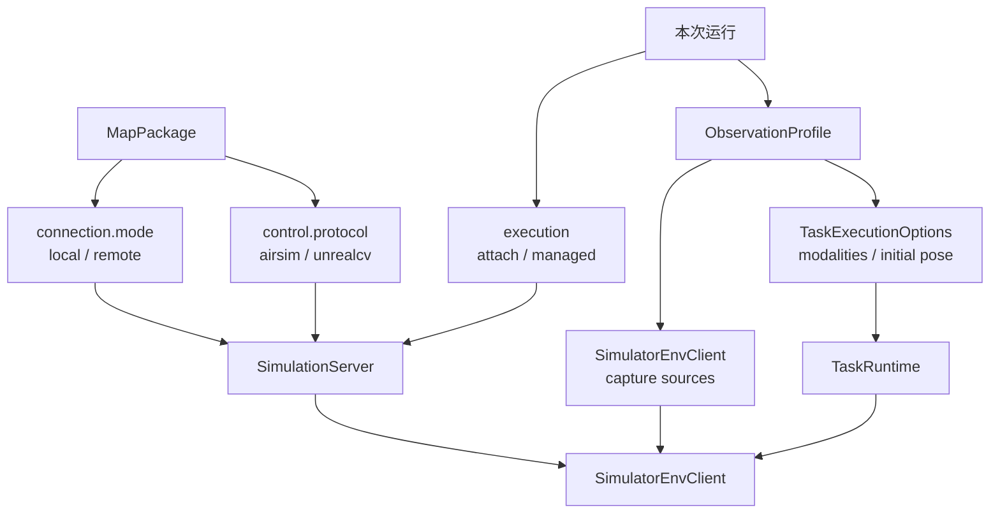
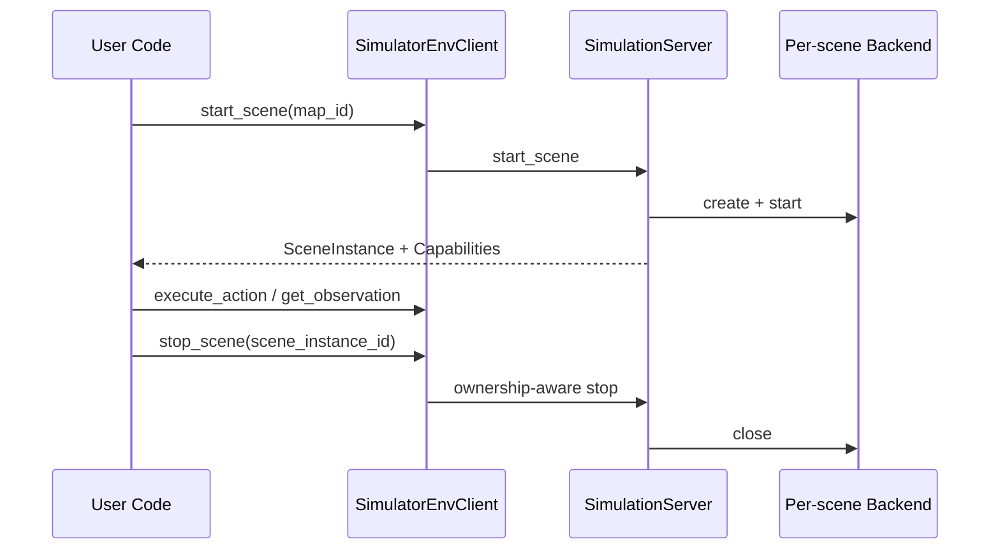

# SimulatorEnvClient 使用方式

> Status: Implemented  
> Previous: [09_migration_and_acceptance.md](09_migration_and_acceptance.md)  
> Next: [11_scenario_cookbook.md](11_scenario_cookbook.md)

EnvClient v1 已冻结。准确的方法、返回 Schema 和兼容规则见
[13_envclient_api_contract.md](13_envclient_api_contract.md)。

## 一个 Client，四个独立决定

使用者只创建一个 `SimulatorEnvClient`。最终使用本地还是远程、AirSim
还是 UnrealCV，不通过 Client 子类区分：



- `connection.mode`：场景部署在哪里；
- `control.protocol`：Backend 使用什么模拟器协议；
- `execution`：本次运行是否可以拥有并管理 UE 进程。
- `ObservationProfile`：本次 Benchmark/Runtime 如何取得 canonical 观测。

第三项故意不写进 MapPackage。同一张地图可以 attach 到人工启动的 UE，也可以
切换到 EnvClient 托管启停，不需要复制地图配置。配置离线检查不创建 Server 场景。

## 最小代码

```python
from src.env_client import SimulatorEnvClient, load_observation_profile
from src.runtime.configs import InitialPose, TaskExecutionOptions
from src.runtime.configs.map_config import load_map_config
from src.sim_server.execution import SimulationExecutionMode
from src.sim_server.server import SimulationServer

maps, port_policy = load_map_config(
    "configs/maps/simulator_control_demo.example.json"
)

server = SimulationServer(
    maps,
    port_policy,
    run_dir="runs/my_simulator_run",
    execution_mode=SimulationExecutionMode.MANAGED,
)
profile = load_observation_profile(
    "configs/observations/airsim_default.example.json"
)
client = SimulatorEnvClient(server, observation_profile=profile)
options = TaskExecutionOptions.from_observation_profile(
    profile,
    initial_pose=InitialPose(
        x=12.0,
        y=-4.0,
        z=8.0,
        yaw_deg=90.0,
    ),
)

scene = client.start_scene("demo_local_airsim_cv")
try:
    client.execute_action(
        scene.scene_instance_id,
        "uav_1",
        "connect",
        {},
    )
    observation = client.get_observation(
        scene.scene_instance_id,
        "uav_1",
        ["rgb", "depth", "pose"],
    )
finally:
    client.stop_scene(scene.scene_instance_id)
```

上面的底层示例仍然展示直接 EnvClient 调用。交给 Agent 执行任务时，将同一个
`profile`生成的 `options`传入 Runtime：

```python
state = runtime.run_task(
    "demo_local_airsim_cv",
    "沿道路向前飞行并在路口悬停",
    execution_options=options,
)
```

Benchmark Adapter 负责把数据集原始坐标和四元数转换成 canonical `InitialPose`。
Runtime 在 connect、必要的 takeoff 和 hover 之后设置起点，再稳定并采集首帧。
该 `set_pose`只记录为 episode 初始化审计事件，不是 Planner 动作。

调用者不需要：

- 实例化 `AirSimBackend`或 `UnrealCvBackend`；
- 判断是否创建 SSH Tunnel；
- 上传 Remote Worker；
- 按进程名结束 UE；
- 为 Local/Remote 创建不同 EnvClient。

## ObservationProfile

ObservationProfile 是 Benchmark/Runtime 级配置，不是 MapPackage 字段，也不写入
episode：

```json
{
  "modalities": ["rgb", "depth", "pose"],
  "capture_sources": {
    "rgb": "scene",
    "depth": "depth_vis"
  }
}
```

Profile 仍使用 canonical 输出名。Agent 请求的是 `depth`，上层 Profile 决定它来自
`depth_vis`还是 `depth_perspective`。AirSim Backend 只执行通用 capture source，
不读取 `map_id`、`scene_id`或 Benchmark 名称。

默认 Profile：

```text
rgb   → scene
depth → depth_perspective
pose  → pose
```

同一 MapPackage 可以创建多个 Client，并为每个 Client 注入不同 Profile；部署配置、
settings 和进程 ownership 不需要复制或修改。

`modalities`不会由 EnvClient 静默覆盖 `get_observation()`的显式参数。
TaskRuntime 通过 `TaskExecutionOptions.from_observation_profile()`消费它，并在场景启动后
根据 `SceneCapabilities.observation_modalities`做快速校验。v1 要求 modalities 包含
`pose`，但 `rgb`和 `depth`可以按 Benchmark 的 Agent 输入配置选择。

## SimulationExecutionMode

```python
from src.sim_server.execution import SimulationExecutionMode
```

| Mode | 真实 SDK/RPC | Remote SSH/Tunnel | 启动 UE | `stop_scene` |
|---|---:|---:|---:|---|
| `ATTACH` | 是 | Remote 时使用 | 绝不启动 | 保留外部 UE |
| `MANAGED` | 是 | Remote 时使用 | 允许 | 只停止 owned UE |

字符串形式也可以传入：

```python
SimulationServer(..., execution_mode="attach")
SimulationServer(..., execution_mode="managed")
```

默认值是 `managed`。无效字符串（包括已经移除的 `dry-run`）会在 Server
构造时失败，不会等到启动场景后再解释。

### 离线配置检查

Simulation execution 不再提供 Fake Backend。只想检查 MapPackage 时，不要调用
`start_scene()`：

```powershell
python demos/simulator_env_client_demo.py --list-maps
```

该命令只读取本地 JSON，不创建 `SimulationServer`场景，不调用 SDK、SSH、
Tunnel 或 executable。自动化测试需要 Fake Backend 时显式注入测试 Registry，
生产模式不会根据 execution 隐式切换到 Fake Adapter。

### ATTACH

`ATTACH`适合 UE 已由人工、作业系统或其他工具启动的情况：

- Local 直接探测配置中的 endpoint；
- Remote 先通过 SSH 建立 Tunnel，再做协议探测；
- endpoint 不健康时直接失败；
- ownership 为 `external`；
- `stop_scene`只关闭 SDK client 和 Tunnel，不停止 UE。

### MANAGED

`MANAGED`允许 EnvClient 管理进程：

- Local 使用 MapPackage executable 启动并记录 PID；
- Remote 先尝试 attach；
- Remote 协议健康时仍使用外部 UE，ownership 为 `external`；
- Remote 端口关闭时上传一次性 Worker 并启动 UE；
- Worker 启动的场景 ownership 为 `remote_managed`；
- stop 前验证 PID、start ticks 和 executable。

`SimulationServer`、主 CLI 和统一底层 Demo 均默认使用 `MANAGED`。如果调用者要求
绝不启动场景，必须显式选择 `ATTACH`。

因此不能只看到 `execution=managed`就假设 UE 一定由本次运行启动。事实来源是
`SceneInstance.process_ownership`。

## SceneInstance

启动后重点检查：

```text
scene_instance_id
control_host / control_port
process_ownership
process_id / remote_process_id
settings_sha256
capabilities
```

Remote Backend 看到的 `control_host/control_port`是本地 Tunnel endpoint，
不是必须对公网开放的远端 RPC 地址。

## SceneCapabilities

```python
caps = scene.capabilities

if caps.requires_takeoff:
    client.execute_action(scene.scene_instance_id, "uav_1", "takeoff", {})

if caps.supports("hover"):
    client.execute_action(scene.scene_instance_id, "uav_1", "hover", {})
```

不要根据 `map_id`猜测动作：

- Multirotor 需要 takeoff/land；
- AirSim ComputerVision 使用 pose control，不支持 takeoff/land；
- UnrealCV 控制 camera pose，不支持 takeoff/land；
- soft reset 必须检查 `supports_soft_reset`。

## Observation 归一化

EnvClient 返回原始 `Observation`。如果需要统一读取 pose 和 frames，使用项目已有
边界：

```python
from src.perception.raw_observation import RawObservation

raw = RawObservation.from_env_observation(observation)
print(raw.pose)
print(raw.frames)
```

它只移除 `pose.pose`和 `frames.frames`等传输包装，不做目标识别或语义推断。

AirSim artifact 格式由 Adapter 正确处理：

- raw Scene RGB 会先按宽、高和通道解析，再编码为 PNG；
- DepthPerspective 保存二维浮点 `.npy`；
- DepthVis 保存标准化 `.npy`，并额外生成 `depth_preview/*.png`供人工检查；
- 是否保存 artifact 不会改变 AirSim RPC 的压缩或像素格式。

## 生命周期与清理



始终使用 `try/finally`。不要用 `pkill`、按端口杀进程或绕过 EnvClient 直接关闭
Remote Worker。
