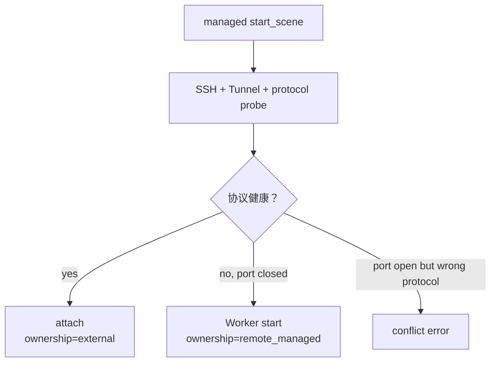

# 场景选择手册

> Status: Implemented  
> Previous: [10_envclient_usage.md](10_envclient_usage.md)  
> Next: [12_demo_walkthrough.md](12_demo_walkthrough.md)

## 我应该选什么

| 当前情况 | MapPackage | execution | 结果 |
|---|---|---|---|
| 只想检查配置 | 任意 Local/Remote | 不启动场景 | 使用 `--list-maps` |
| 本地 UE 已人工启动 | `connection.mode=local` | `attach` | 连接但不停止 UE |
| 希望 EnvClient 启动本地 UE | `connection.mode=local` | `managed` | 启动并停止 owned PID |
| 远程 UE 已人工启动 | `connection.mode=remote` | `attach` | SSH Tunnel + 协议连接 |
| 远程 UE 可能开着，也可能没开 | `connection.mode=remote` | `managed` | attach-or-start |
| 只想更换 AirSim/UnrealCV | 改 `control.protocol` | execution 不变 | Registry 选择 Backend |

## 先执行无副作用配置检查

```powershell
python demos/simulator_env_client_demo.py --list-maps
```

该入口会列出示例配置中的四种 Local/Remote × AirSim/UnrealCV 组合，只读取
本地 JSON。默认直接运行 Demo 则使用 `managed`，会连接或启动配置中的真实 UE。

## Local AirSim

### 连接人工启动的 UE

MapPackage 保留真实 AirSim endpoint：

```json
{
  "connection": {"mode": "local"},
  "control": {"protocol": "airsim"},
  "airsim": {
    "host": "127.0.0.1",
    "port": 41451,
    "mode": "Multirotor"
  }
}
```

运行：

```powershell
python demos/simulator_env_client_demo.py `
  --config configs/maps/airvln_maps.json `
  --map-id airvln_demo_manual `
  --execution attach `
  --save-artifacts
```

`stop_scene`不会停止人工启动的 UE。

### EnvClient 托管本地 UE

配置 executable/root 后：

```powershell
python demos/simulator_env_client_demo.py `
  --config configs/maps/airvln_maps.json `
  --map-id cityenviron_win64 `
  --execution managed `
  --save-artifacts
```

Local managed 不使用 SSH。启动成功后 ownership 为 `local`。

## Remote AirSim

### 已启动：只 attach

```powershell
$env:FLYAGENT_SSH_KEY = "C:\path\to\private_key"

python demos/simulator_env_client_demo.py `
  --config configs/maps/remote_ssh.example.json `
  --map-id airsim_remote_env_1 `
  --execution attach `
  --save-artifacts
```

流程：

```text
SSH preflight
→ 下载并验证 settings
→ 建立 Tunnel
→ AirSim RPC probe
→ ownership=external
```

AirSim 未启动时 attach 明确失败，不会自动启动。

### 不确定是否已启动：managed

```powershell
python demos/simulator_env_client_demo.py `
  --config configs/maps/remote_ssh.example.json `
  --map-id airsim_remote_env_1 `
  --execution managed `
  --move-forward-m 0.5 `
  --save-artifacts
```

流程：



即使 execution 是 managed，已存在且健康的 UE 仍保留 external ownership。

## Local UnrealCV

自由相机地图使用：

```json
{
  "control": {"protocol": "unrealcv"},
  "unrealcv": {
    "host": "127.0.0.1",
    "port": 9010,
    "camera_id": 0,
    "control_target": "camera"
  }
}
```

存在主 UAV Actor 的地图使用：

```json
{
  "control": {"protocol": "unrealcv"},
  "unrealcv": {
    "host": "127.0.0.1",
    "port": 9068,
    "camera_id": 0,
    "control_target": "actor",
    "actor": {
      "name": "BP_Drone01_2",
      "units_per_meter": 100.0,
      "yaw_offset_deg": -180.0,
      "rotation_method": "blueprint_yaw",
      "camera_follow": "standard_pose",
      "disable_physics": true,
      "yaw_settle_timeout_sec": 5.0,
      "yaw_tolerance_deg": 1.0
    }
  }
}
```

```powershell
python demos/simulator_env_client_demo.py `
  --config <your-unrealcv-map-config.json> `
  --map-id <your-map-id> `
  --execution managed `
  --save-artifacts
```

两种模式都：

- 不执行 takeoff；
- `move_body`改变配置目标的位置；
- `turn_relative`改变配置目标的 yaw；
- `hover`保持当前目标 pose；
- `stop_scene`根据 ownership 决定是否停止 executable。

Actor 模式返回 `control_mode=actor_pose`并把位置统一为米。Camera 模式返回
`control_mode=camera_pose`，用于没有独立 UAV Actor 的地图。

DowntownWest 的真实诊断命令和验收结果见
[14_local_unrealcv_test.md](14_local_unrealcv_test.md)。

## Remote UnrealCV

Remote UnrealCV 与 Remote AirSim 共享 SSH/Tunnel/Worker，差别只在：

```json
{
  "control": {"protocol": "unrealcv"},
  "unrealcv": {
    "remote_host": "127.0.0.1",
    "port": 9010,
    "camera_id": 0
  }
}
```

可以先通过统一列表离线确认路由：

```powershell
python demos/simulator_env_client_demo.py --list-maps
```

仓库目前没有可供真实验收的 Remote UnrealCV 主机，因此文档不声明其实机通过。

## AirSim ComputerVision 与 Multirotor

两者都使用 `control.protocol=airsim`，由 settings 和：

```json
{"airsim": {"mode": "ComputerVision"}}
```

或：

```json
{"airsim": {"mode": "Multirotor"}}
```

选择控制策略。不要在用户代码中解析 mode 后手写两套调用；读取
`SceneCapabilities`即可。

## Benchmark 如何使用

Benchmark 仍只选择：

```text
map_id
scene_id
start_pose
```

SSH host、key、UE executable、protocol、execution mode、GPU 和 settings 不属于
episode，也不进入 Agent context。Benchmark 可以在启动 Runtime 时选择一份
Deployment Profile，但不直接操作 SSH 或 Backend。
