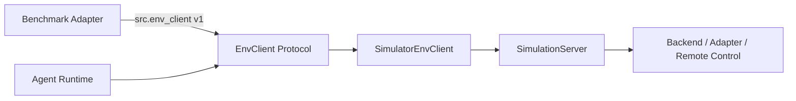

# EnvClient v1 公共接口契约

> Status: Implemented  
> API Version: `1.0`  
> Previous: [12_demo_walkthrough.md](12_demo_walkthrough.md)

## 冻结目标

Benchmark、Runtime 和测试替身只依赖 `src.env_client` 的公共导出。模拟器协议、
本地/远程部署、SSH、进程控制和 Backend 注册都属于内部实现，可以在不改变
EnvClient v1 的情况下继续演进。



稳定导入方式：

```python
from src.env_client import (
    ENV_CLIENT_API_VERSION,
    ActionResult,
    EnvClient,
    Observation,
    ObservationProfile,
    SceneCapabilities,
    SceneInstance,
    SimulatorEnvClient,
    load_observation_profile,
)
```

不要让 Benchmark 直接导入：

```text
src.sim_server.*
src.adapters.*
src.sim_server.remote.*
```

## v1 方法

```python
class EnvClient(Protocol):
    def start_scene(
        self,
        map_id: str,
        scene_id: str | None = None,
    ) -> SceneInstance: ...

    def get_or_start_scene(
        self,
        map_id: str,
        scene_id: str | None = None,
    ) -> SceneInstance: ...

    def stop_scene(self, scene_instance_id: str) -> None: ...

    def reset_scene(self, scene_instance_id: str) -> SceneInstance: ...

    def health_check(self) -> bool: ...

    def get_observation(
        self,
        scene_instance_id: str,
        agent_id: str,
        modalities: list[str],
    ) -> Observation: ...

    def execute_action(
        self,
        scene_instance_id: str,
        agent_id: str,
        action: str,
        args: dict,
    ) -> ActionResult: ...
```

`SimulatorEnvClient` 构造签名同样属于 v1：

```python
SimulatorEnvClient(
    service,
    observation_profile: ObservationProfile | None = None,
)
```

ObservationProfile 是一次 Benchmark 运行的静态观测选择。它不进入 MapPackage，
也不作为逐 episode 真值传入方法参数，因此 `get_observation()` 的公开签名保持稳定。

## 返回 Schema

以下类型及字段属于 v1：

- `SceneInstance`
  - 场景标识、控制 endpoint、进程 ownership、settings hash 和 capabilities；
- `SceneCapabilities`
  - 协议、控制模式、动作、观测、takeoff 和 soft-reset 能力；
- `Observation`
  - `scene_instance_id`、`agent_id`、`modalities`、`data`；
- `ActionResult`
  - `ok`、`action`、`message`、`data`。

`Observation.data` 和 `ActionResult.data` 是扩展容器。Backend 可以增加新的内部键，
但不能改变已有 canonical 字段的含义。调用方必须依据 `SceneCapabilities` 判断动作
和观测是否可用，不能根据 `map_id` 或 Benchmark 名称推断。

例如 Backend 可以在已有 Pose 字典中增加可选`agl_m`。字段缺失表示该部署没有可靠
地面参考；这不增加新的 EnvClient 方法，也不改变 Pose 既有坐标字段的含义。

## 兼容规则

下列修改保持在 v1 内：

- 修复 Backend、Adapter、SSH 或进程生命周期；
- 增加新的 Backend 注册；
- 增加新的 action 名称或 observation modality，并通过 capabilities 宣告；
- 在扩展容器中增加不冲突的可选数据；
- 优化性能、重试、日志和 artifact。

下列修改必须先升级 EnvClient 主版本并提供迁移说明：

- 删除或重命名公开方法；
- 增加必填方法参数或改变参数顺序、默认值；
- 改变方法返回类型；
- 删除、重命名公开 Schema 字段；
- 改变 ownership、reset、stop 或 observation 的既有语义；
- 要求 Benchmark 直接操作 SimulationServer、Backend、SSH 或 SDK。

新能力优先通过以下方式扩展：

```text
新模拟器协议 → 新 Backend + Registry
新部署方式   → Process/Remote Control
新观测来源   → ObservationProfile + Adapter registry
新动作       → Backend capability + canonical action
新评测数据   → Benchmark Adapter / Evaluation
```

## 自动化保护

`tests/test_env_client_api_contract.py` 锁定：

- API 版本和稳定导出；
- 七个公开方法及其参数、顺序和默认值；
- `SimulatorEnvClient` 构造参数；
- Protocol 的结构化多态；
- 四个返回 Schema 的字段集合和顺序。

如果这些测试失败，不应直接更新期望值。先判断修改是否能放进 Backend、
ObservationProfile、capabilities 或扩展数据；确实需要破坏兼容时，再设计 EnvClient
v2 和迁移周期。
