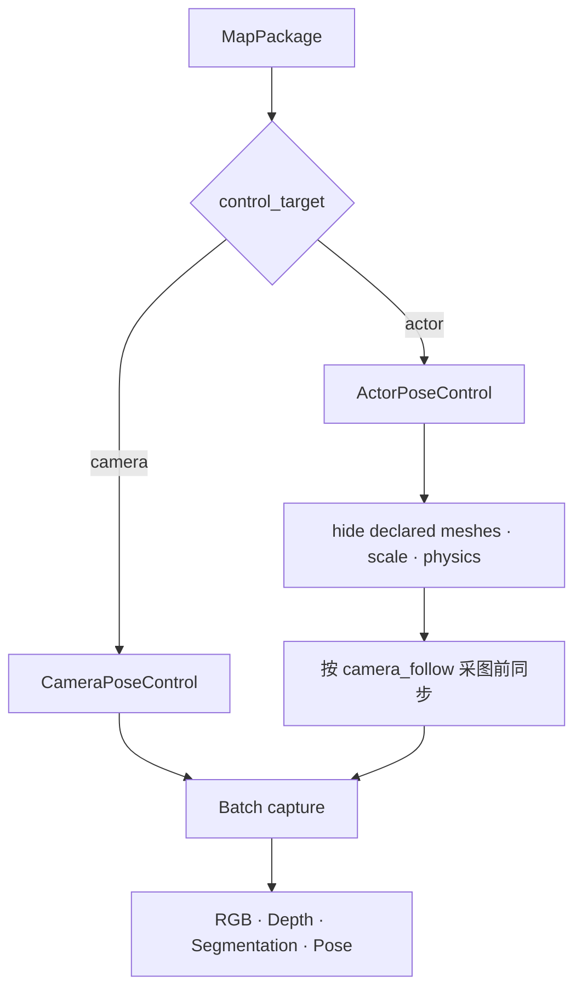

# Local UnrealCV Actor 控制与真实验收

> Status: Implemented  
> Scope: 本地 packaged UE、UnrealCV Actor 控制、观测和 owned process 清理  
> Previous: [13_envclient_api_contract.md](13_envclient_api_contract.md)  
> Index: [README.md](README.md)

## 为什么需要 Actor 模式

UnrealCV 协议允许直接修改 camera pose，但部分游戏地图会在 Tick 中继续驱动相机。
这类地图若只控制 `/camera/0`，一次转向可能同时产生不可控的位置漂移。



`actor`模式控制地图显式声明的主 UAV Actor，并把 UE native units 转成米。Backend
不会按地图名猜 Actor，也不会在 Actor 失败时回退到 camera。

## Camera 与 Actor 的选择

| 地图条件 | 配置 | Pose |
|---|---|---|
| 地图只暴露自由相机 | `control_target=camera` | 原生 camera pose |
| 地图暴露可控 UAV/机器人 | `control_target=actor` | 米制 Actor pose |
| 地图通过 Blueprint 控制 Actor yaw | `rotation_method=blueprint_yaw` | pitch/roll 只读 |
| 地图自动让相机跟随 Actor | `camera_follow=none` | 不额外同步 |
| 标准 UnrealCV camera 可写 | `camera_follow=standard_pose` | 采图前同步 |
| 地图提供 `set_cam` Blueprint | `camera_follow=blueprint_pose` | 采图前同步 |

`disable_physics=true`会在连接后对主 Actor 执行显式的 physics disable。它只作用于
主控制目标，不会改变 Benchmark 人物、车辆或其他场景对象。
可选的`scale=[x,y,z]`同样只在 Backend prepare 时设置一次，用于恢复打包地图
声明的主 Actor 初始比例。
`startup.hide_objects`用于隐藏打包地图自带、且已明确命名的 mesh，同时保留
Actor 控制和 camera component。它可以包含主控制 Actor 以隐藏自机机身，但不能
包含 Benchmark 在 episode 中创建的目标。

## DowntownWest 已确认部署

```text
Executable:
G:\Unrealzoo-UE4\Collection_WinNoEditor_0424_25\
Collection\Binaries\Win64\Collection.exe

Map argument: DowntownWest
UnrealCV port: 9068
Actor: BP_Drone01_2
Actor scale: [0.1, 0.1, 0.1]
Startup hide: BP_Character_2, BP_animal_2, BP_BaseCar_2, Sport_2, BP_Drone01_2
Camera: 0
Native units per meter: 100
Yaw offset: -180 deg
Camera follow: standard_pose
Blueprint yaw settle: timeout 5 s, tolerance 1 deg
```

`blueprint_pose` 中的 `set_cam` 由 camera-owning Actor 接收，数字 camera id 不能
直接作为 `vbp` Actor id；例如 `vbp 0 set_cam ...` 在 DowntownWest 会明确返回找
不到 Actor。当前 Collection 二进制还会对
`vbp BP_Drone01_2 set_cam/set_viewport` 返回成功但不移动 camera 0/1，因此
DowntownWest 不能选择该策略，必须使用已验证的 `standard_pose` 同步 capture camera。

`Collection\Binaries\Win64\unrealcv.ini`中的 `Port`必须与 MapPackage 的
`unrealcv.port`一致。通用底层不会修改打包环境目录中的 ini 文件。

便携示例：

[unrealcv_actor_control.example.json](../../configs/maps/unrealcv_actor_control.example.json)

复制示例后只替换本机 `root`，不要把 episode、instruction、target、reference path
或指标写入 MapPackage。

## 运行高注释 Probe

默认命令只启动、连接和采图，不移动：

```powershell
python tests/manual/unrealcv_local_actor_probe.py `
  --config <your-local-config.json> `
  --map-id downtownwest_local_unrealcv `
  --execution managed `
  --require-visual `
  --require-first-person
```

安全动作闭环：

```powershell
python tests/manual/unrealcv_local_actor_probe.py `
  --config <your-local-config.json> `
  --map-id downtownwest_local_unrealcv `
  --execution managed `
  --yaw-deg 10 `
  --move-forward-m 0.25 `
  --speed-mps 0.5 `
  --require-visual `
  --require-first-person
```

执行顺序：

```text
start_scene
→ connect actor
→ batch RGB/depth/segmentation
→ turn_relative
→ move_body
→ set_pose 恢复
→ 再次 batch capture
→ stop owned SceneInstance
```

验收阈值：

- 转向位置漂移不超过 0.05 米；
- yaw 误差不超过 2 度；
- 前移实际位移为 0.20–0.30 米；
- 恢复位置误差不超过 0.05 米；
- RGB 非纯色，Depth 有限且非恒定；
- `--require-first-person` 会在 Backend 隐藏 mesh 前读取主 Actor 的 object-mask
  颜色，并确认初始、转向、移动和恢复后的 Segmentation 中该颜色像素数均为零；
- `MANAGED`启动的进程在结束后关闭。

## 输出

```text
runs/manual_local_unrealcv_probe/<run-id>/
├── resolved_map_package.json
├── scene_instance.json
├── summary.json
├── poses.json
├── scenes/<scene-instance-id>/process.log
└── artifacts/<scene-instance-id>/
    ├── rgb/
    ├── depth/
    ├── depth_preview/
    └── segmentation/
```

`summary.json`记录实际 capability、ownership、转向漂移、移动距离、恢复误差、自机
mask 像素数和清理状态。图像质量及第一视角判断只属于这个验收工具，不进入 Backend。

## Benchmark 边界

底层可以控制主 UAV Actor，但不能决定“目标对象应该放在哪里”：

| 能力 | Owner |
|---|---|
| 启动地图、连接端口 | SimulationServer |
| 主 UAV Actor pose、camera follow | UnrealCvBackend |
| RGB/Depth/Segmentation/Pose | UnrealCvBackend |
| 人物/车辆创建、隐藏、外观和位置 | Benchmark Scenario |
| episode 起点、reference path、SR/nDTW | Benchmark/Evaluation |

UAV-Flow 后续迁移时，Benchmark 仍负责 case 场景设置；它只把飞行动作和观测改为
调用冻结的 EnvClient。

## 故障排查

### 端口连接失败

检查 `unrealcv.ini`、MapPackage 端口和 9068 是否被其他进程占用。`attach`不会启动
地图；需要自动启动时使用 `managed`。

### Actor 不存在

确认地图实际 Actor 名称。Backend 不会猜测或回退到 camera，因为那会让动作表面
成功但实际控制错误对象。

### Blueprint 命令错误

只有地图明确提供对应扩展时才使用`blueprint_yaw`或`blueprint_pose`。可以直接写
UnrealCV camera 的地图使用`camera_follow=standard_pose`；已经自动跟随 Actor 的
地图选择`none`。

DowntownWest 的 `set_rotation` Blueprint 在命令侧需要地图配置的
`yaw_offset_deg`，并在 UE 内部继续完成 mesh 朝向修正和逐步插值。完成后的 Actor
readback 是相机物理 yaw，Backend 将其作为 canonical yaw，并等待 readback 达到
`yaw_tolerance_deg`，不会在命令刚发出时返回尚未实现的目标 pose。

### 有连接但画面不变

检查 `summary.json`中的 command、artifact 和 capture group，再查看
`scenes/<id>/process.log`。Backend 允许合法暗场景；`--require-visual`才会把恒定
画面视为实机验收失败。

### RGB 出现第一人称手臂或无人机机身

先对照旧环境初始化和最终 `get_image` 调用，而不是只看 Actor 的 camera 声明。
DowntownWest 的 Drone 配置声明 camera 1，但旧 batch 最终采集 camera 0。它的
`vbp 0 set_cam` 返回错误且旧客户端未校验；当前 Backend 不继承这个无效成功，而是
用 `standard_pose` 将 camera 0 对齐到受控 Actor。旧 Gym
会先把主 Actor scale 设置为`[0.1, 0.1, 0.1]`，并移除非 drone 的默认人物、
动物和车辆 Pawn。当前 Backend 为保持固定 camera id，不销毁 camera-owning Pawn，
而是通过`startup.hide_objects`隐藏相同的默认 mesh，并隐藏自机 mesh。确认
MapPackage 同时声明正确的`actor.scale`和`startup.hide_objects`，再通过真实
Turn、Move、Approach 首帧及动作帧验证构图。

这里不是用自由 camera 代替无人机运动。`control_target=actor`仍然移动和读取
`BP_Drone01_2`；`standard_pose`只负责让 capture camera 跟随 Actor；`hide_objects`
只关闭自机 mesh 的渲染。若将`control_target`改为`camera`，才会变成 camera-only
位姿控制，这不是 DowntownWest 的 UAV-Flow 配置。

## 2026-08-20 第一视角修复验收

真实底层闭环：

```text
runs/manual_local_unrealcv_probe/20260820_181150_572952
```

- 初始、转向、移动、恢复四张 Segmentation 中，`BP_Drone01_2`颜色
  `[23, 127, 47]`的像素数均为 0；
- 四张 RGB 人工抽查均没有自机机身；
- 10°转向实际为 9.846°，位置漂移 0 m；
- 前移 0.25 m 实际为 0.250005 m；
- 恢复位置误差 0 m，yaw 误差 0.434°；
- owned Collection 进程已停止，9068 已关闭。

真实 UAV-Flow 单 case canary：

```text
evaluation/benchmarks/uav_flow/outputs/uav_flow_first_person_canary_20260820
```

case `2025-03-30_11-49-14`以`status=ok`完成，产生 36 张 RGB 和 35 个正式动作。
Planner 的最终模型请求同时包含 phase-start RGB、当前 RGB 和
`current_rgb_depth_overlay`；抽查第 1、16、36 张 RGB 均无自机。该 canary 只验证
真实 Agent 输入与第一视角部署链路，不把单 case 的任务指标作为相机验收条件。

## 最近一次真实结果

验证时间：2026-07-30  
调用链：`SimulatorEnvClient → SimulationServer → UnrealCvBackend`  
Execution：`MANAGED`  
Run：`runs/manual_local_unrealcv_probe/20260730_192119_692593`

| 项目 | 结果 |
|---|---|
| Status | `completed` |
| Scene capability | `unrealcv / actor_pose` |
| Process ownership | `local` |
| RGB | 256×256，std=59.089，40359 colors |
| Depth | 256×256，finite，std=247.391 m |
| Segmentation | 256×256，297 colors |
| 10°转向 | 实际 9.864°，位置漂移 0 m |
| 0.25 m 前移 | 实际 0.249997 m |
| 位姿恢复 | 位置误差 0 m，yaw 误差 0.5° |
| Cleanup | owned process stopped，9068 关闭 |

真实调试还确认了两个容易误解的协议行为：

1. 直接启动的 DowntownWest 不接受 `vbp 0 set_cam`，因此该地图使用标准 camera pose
   同步；
2. `vbp <actor> set_rotation`接收 canonical 目标 yaw，但 Actor 会插值到目标，不能在
   命令刚返回时就把目标值当成真实 pose。

最终实现使用 Actor readback 等待 yaw 收敛。RGB、Depth、Segmentation 和动作均由
统一 EnvClient 获取，不使用旧 UAV-Flow adapter 代替验收。

## 2026-07-30 TaskRuntime 对齐验收

在上述 Backend 闭环通过后，又使用确定性 Completion Planner 验证了完整 Runtime
初始化路径：

```text
runs/manual_task_runtime_probe/task_runtime_probe_20260730_232925_cd9595/
```

该 Probe 先读取当前 Actor pose，再把同一 pose 作为
`TaskExecutionOptions.initial_pose`，因此没有执行规划飞行动作。

| 项目 | 结果 |
|---|---|
| Status | `completed` |
| Scene capability | `unrealcv / actor_pose` |
| Process ownership | `local` |
| requires_takeoff | `false` |
| Runtime takeoff | `preflight_takeoff_skipped`，无 takeoff 调用 |
| Planner tools | `uav.hover`、`uav.turn_relative`、`uav.move_body` |
| simulator_contract | 已写入 Planner Context，无 host/port/path |
| Observation | RGB、Depth、Pose artifacts 已生成 |
| Initial/final position | 一致 |
| Cleanup | `completed=true`，9068 关闭，无 Collection 残留 |

该结果验证的是“统一 Backend 能否被 TaskRuntime 正确消费”，不替代前一节包含转向、
移动和恢复的底层动作验收。
