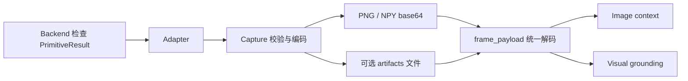

# 真实后端与图像载荷

生产执行只允许显式指定模式：UAV-Flow/AerialVLN 使用 `attach` 或
`managed`，TravelUAV 使用 `managed`。旧 `dry` 配置会报迁移错误，
不会自动改成真实执行。数据选择、指标、报告和 AerialVLN/TravelUAV 的
`--validate-only` 仍可离线使用。

Backend 在 scene 启动时创建真实 Adapter；自动测试通过工厂或 Adapter
参数显式注入测试替身。Fake 仅在 `tests/`，不是可选的生产后端。
memory demo 只写静态记录，不执行模拟飞行。

## 分层



- AirSim 的图像协议和文件保存位于 `src/adapters/airsim/capture.py`。
- 两个 Adapter 的连接释放逻辑位于各自 `client.py`；连接错误保留为主错误，
  同时发生的关闭失败附加到 `cleanup_errors`。Probe 保留连接结果并补充关闭诊断。
- Backend 拒绝失败的 pose/frame 结果，不把失败传感器包装成正常 Observation。
- `src/perception/frame_payload.py` 读取现有 artifact 文件或 base64。
  文件缺失时可使用有效内存载荷；损坏的图像、NPY、base64 或尺寸不一致明确失败。

## 保存开关与深度语义

`save_artifacts=False` 不创建 backend 图像文件，但仍返回可消费的载荷：
RGB/segmentation 为 PNG，depth 为 NPY。尺寸、载荷长度与解码检查始终执行。
开启时，文件内容与返回的内存载荷一致，并保留已有 preview 行为。
FlightMemory/audit 仍可保存载荷；该开关不表示禁止审计落盘。

AirSim DepthPerspective 声明 `depth_unit=meter`；DepthVis 声明
`depth_unit=normalized`。DepthVis 不能用于米制目标距离或米制叠加图。
视觉工具可直接读取内存 RGB/depth，不需要临时 backend 图片。

## 验证入口

```powershell
python -m pytest tests/test_backend_observation_failures.py tests/test_frame_payload.py tests/test_real_execution_contract.py -q
python demos/memory_system_demo.py --run-root runs
```

实机图像与动作探针使用 `tests/manual/airsim_action_regression_probe.py`，
通过 `--save-artifacts` / `--no-save-artifacts` 分别验证两条存储路径。
UnrealCV 使用 `tests/manual/unrealcv_local_actor_probe.py`。
这些探针是基础设施验收，不是模型 benchmark 成功率。
