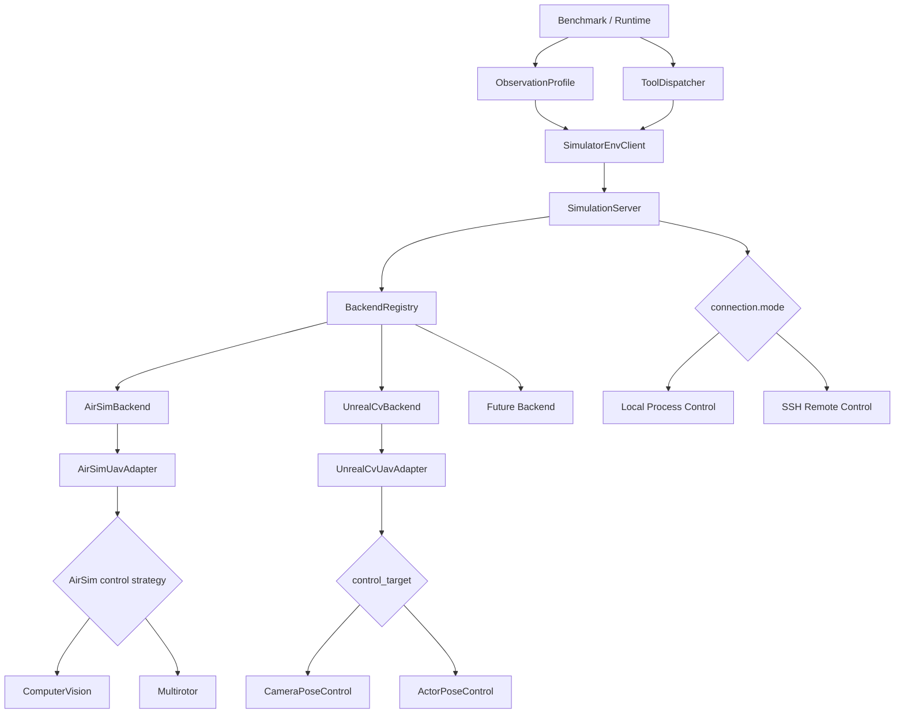

# 模拟器控制架构文档

> Status: Implemented  
> Scope: EnvClient、SimulationServer、Backend、Adapter、本地/远程部署  
> Validation: 全量自动化测试、真实远程 AirSim env_1 和真实本地 UnrealCV
> DowntownWest 严格视觉闭环均已通过；详情见
> [08_remote_airvln_test.md](08_remote_airvln_test.md) 与
> [14_local_unrealcv_test.md](14_local_unrealcv_test.md)。

## 文档目的

本目录是 FlyAgent 模拟器控制层的单一设计入口，用于回答四个问题：

1. Agent 和 Benchmark 如何通过同一个 EnvClient 使用不同模拟器；
2. 本地与远程 UE 如何复用同一套 Backend 和 Adapter；
3. AirSim ComputerVision、AirSim Multirotor 和 UnrealCV 的动作语义如何统一；
4. 如何验证命名、路由、场景隔离和进程 ownership。

图中的 `BackendRegistry`、per-scene Backend、SceneCapabilities 和 Remote 子包均已落地。真实 Linux UE 验收与代码实现状态分开记录，网络不可达时不会把模拟测试写成实机通过。

## 推荐阅读顺序

- 理解整体边界：[01_scope_and_boundaries.md](01_scope_and_boundaries.md) → [03_target_architecture.md](03_target_architecture.md) → [04_scene_lifecycle_and_capabilities.md](04_scene_lifecycle_and_capabilities.md)
- 开发新模拟器：[03_target_architecture.md](03_target_architecture.md) → [06_backend_and_adapter_contracts.md](06_backend_and_adapter_contracts.md) → [07_configuration_reference.md](07_configuration_reference.md)
- 配置远程 UE：[05_local_and_remote_deployment.md](05_local_and_remote_deployment.md) → [07_configuration_reference.md](07_configuration_reference.md) → [08_remote_airvln_test.md](08_remote_airvln_test.md)
- 实施代码迁移：[02_current_state_and_debt.md](02_current_state_and_debt.md) → [09_migration_and_acceptance.md](09_migration_and_acceptance.md)
- 直接使用 EnvClient：[10_envclient_usage.md](10_envclient_usage.md) → [11_scenario_cookbook.md](11_scenario_cookbook.md) → [12_demo_walkthrough.md](12_demo_walkthrough.md) → [13_envclient_api_contract.md](13_envclient_api_contract.md)
- 验证本地 UnrealCV Actor：[07_configuration_reference.md](07_configuration_reference.md) → [14_local_unrealcv_test.md](14_local_unrealcv_test.md)

## 文件索引

| 文档 | 负责内容 |
|---|---|
| [01_scope_and_boundaries.md](01_scope_and_boundaries.md) | Benchmark、Runtime、EnvClient、Backend、Adapter 的责任边界 |
| [02_current_state_and_debt.md](02_current_state_and_debt.md) | 当前代码事实、风险和过期逻辑 |
| [03_target_architecture.md](03_target_architecture.md) | Protocol、Registry、per-scene Backend 目标结构 |
| [04_scene_lifecycle_and_capabilities.md](04_scene_lifecycle_and_capabilities.md) | Scene 生命周期、能力协商、预检和关闭 |
| [05_local_and_remote_deployment.md](05_local_and_remote_deployment.md) | Local/Remote 进程控制、SSH Worker、Tunnel |
| [06_backend_and_adapter_contracts.md](06_backend_and_adapter_contracts.md) | AirSim/UnrealCV Backend 和动作策略契约 |
| [07_configuration_reference.md](07_configuration_reference.md) | MapPackage 配置轴和完整示例 |
| [08_remote_airvln_test.md](08_remote_airvln_test.md) | 已确认远程机器和 env_1 验收流程 |
| [09_migration_and_acceptance.md](09_migration_and_acceptance.md) | 分阶段代码迁移、测试、验收和回滚点 |
| [10_envclient_usage.md](10_envclient_usage.md) | 单一 EnvClient、execution mode、capabilities 和生命周期 |
| [11_scenario_cookbook.md](11_scenario_cookbook.md) | 按 Local/Remote、AirSim/UnrealCV 和进程状态选择配置 |
| [12_demo_walkthrough.md](12_demo_walkthrough.md) | 高注释统一 Demo 的命令、输出和故障排查 |
| [13_envclient_api_contract.md](13_envclient_api_contract.md) | EnvClient v1 稳定导出、方法、Schema 与兼容策略 |
| [14_local_unrealcv_test.md](14_local_unrealcv_test.md) | Local UnrealCV camera/actor 选择、DowntownWest probe 与责任边界 |

## 稳定边界

无论目标架构如何细化，以下约束保持不变：

- Agent 和 Benchmark 不直接调用 AirSim、UnrealCV、SSH 或系统进程接口；
- Benchmark 真值不进入 EnvClient、Runtime 或模型上下文；
- Benchmark runner 可以注入 ObservationProfile，但 Profile 不属于 episode 真值；
- Benchmark 和 Runtime 只依赖 `src.env_client` 的 v1 公共导出；
- Local/Remote 是部署位置，AirSim/UnrealCV 是控制协议，两者互不替代；
- Remote Worker 只管理场景进程，不代理 RGB、Depth、Pose 或动作数据；
- 每个 SceneInstance 必须拥有独立的 Backend/Adapter 状态。
