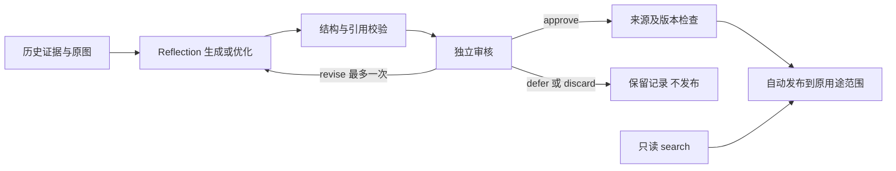

# 飞行经验生成与维护 V2

独立读取落盘记录，生成条件化经验、审核并维护 SQLite 经验库。没有 Core/Runtime 钩子，
没有飞行写入工具；可选 `skill.flight_experience.search` 插件默认禁用。

## 内容与职责

- `evidence.py`：白名单适配原始指令、动作请求、实际反馈、工具结果和原图。隐藏目标、轨迹、
  评测答案及绝对位置不进入模型输入。来源文件、观察 ID 与原图 SHA256 可追溯。
- `prompts/v2`、`contracts.py`：版本化边界、选片、生成、维护、审核、修订与格式修复提示，
  以及严格 JSON Schema。`prompts/v1` 仅用于明确标记的固定上下文对照。
- `calls.py`：独立模型请求、完整审计与按输入内容寻址的阶段检查点。格式不合格最多修复一次，
  修复必须与保留原字符串/引用的结构归一化完全一致；缺字段或新增含义不属于格式修复。
- `generation.py`：每片段最多 3 条经验，独立审核选片，最多一次语义修订并重新审核。
- `maintenance.py`：租约 worker、相关旧经验、变更提案、独立审核及原子发布。
- `store.py`、`publication.py`：不可变版本、来源隔离、检索、事务迁移和新生成经验发布。



经验增加 `decision_question`；适用条件、观察依据、建议、局限及来源引用仍保留。
旧条目不回填虚构问题，仍能读取和检索。数据库版本 1→2 为事务内增量迁移，不改写旧正文。
审核 approve 表示可以发布；revise 提供修改意见而不改正文；defer/discard 不发布。
第二次审核仍要求 revise 时转为 defer。unchanged 只结束维护，不发布原来未发布的候选。

## 调用和异步边界

经验入口默认采用独立 180 秒超时、最多一次超时重试，主飞行配置不变。reflection/reviewer
可分别指定模型，默认继承当前模型连接。严格 JSON Schema 与图片输入需先通过实际连接探测；
不支持时明确失败，不降级模式或更换模型。

每次最多 8 张原图。维护先召回 10 条，再加入目标及最多 2 条相关经验；明确不一致的决策标签
排除，旧记录使用文本检索。词汇相关只用于召回，是否应合并由原始证据和独立审核决定。
引用事件、必要前后窗口和反例不静默截断；独立审核还可选择其他原始反证帧。

worker 使用 120 秒租约并心跳续租。搜索只读已发布快照，不等待模型。失败不改旧发布版本；
来源或基础版本变化阻止提交。相同经验集合、版本、证据、模型设置、提示与 Schema 的任务
可复用已完成的处理；调用检查点只在请求和模型身份完全一致时复用。审核超时可单独恢复，
不重做成功的 reflection。需要重试时手动 enqueue，避免无限模型重试。

V2 独立审核通过后自动发布，不要求人工确认。旧 `awaiting_human` 提案不追溯自动发布，
需重新维护。原有人工查看、撤回和归档入口保留。模型批准不证明建议正确，也不证明飞行收益。

## 来源隔离与检索

离线实验导入始终为 experiment，不可改标签进入 production。普通导入不相信 accepted 字段；
V2 新生成流程经过独立审核、引用校验及来源复核后单独发布。原图在文件中，数据库保存关联。
导入、worker、发布前和 audit 核对来源；search 不扫描全部原日志，因此历史记录应保持只读。

搜索使用 FTS5，NFKC、小写英文词与中文相邻双字切分。默认最多 3 条、上限 5 条、6,000 字符
完整卡片预算；未知条件显式返回，无匹配就为空。不保证语义、跨语言或同义词召回。
经验不能作为当前目标身份、距离或任务完成证据。

## 操作与产物

依赖安装：

```powershell
& 'F:\conda_env\flyagent\python.exe' -m pip install -r plugins/research/flight_experience/requirements.txt
```

生成入口 `tests/manual/flight_experience_probe.py` 保留 inspect/run；支持 `--database`、
`--checkpoints`、`--timeout` 和分别指定模型。不传 database 时在实验目录旁建立独立 SQLite。
输出目录必须全新且在源运行之外。审核图像与完整来源均留在调用审计中。

维护入口 `tests/manual/flight_experience_library.py` 提供 init/import/enqueue/worker/search/
jobs/proposals/show/audit/withdraw/archive。旧 publish 子命令仅用于历史人工待审提案。
初始化命令会事务迁移旧库；旧实验产物保持只读。

操作与 V2 实验步骤见 `tests/manual/flight_experience_v2.md`。历史 V1 操作说明和实验报告只描述当时版本。
